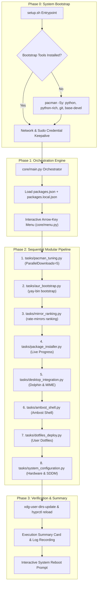

# 🚀 ArchSetup: Arch Linux + Hyprland Post-Install Suite

[](https://archlinux.org)
[](https://hyprland.org)
[](https://python.org)
[](https://github.com/Textualize/rich)
[](https://wayland.freedesktop.org)
[](https://opensource.org/licenses/MIT)

> Reproducible, fast, opinionated, and visually stunning automation suite that turns a minimal Arch Linux installation into a fully configured, daily-driver Hyprland workstation. Run it interactively with arrow keys or script it modularly with CLI flags.

---

## 🎨 Interactive TUI Showcase

ArchSetup features a fully interactive keyboard-driven TUI engine built with native ANSI escape sequence handling. No complex flags required—simply run `./setup.sh` and navigate with `↑/↓` or `j/k`.

### Main Interactive Action Menu

```text
  ╭─╮┬─╮╭─╮┬ ┬   ╭─╮┌─┐┌┬┐┬ ┬┌─┐   User:   manoj
  ├─┤├┬╯│  ├─┤   ╰─╮├┤  │ │ │├─┘   Host:   archlinux
  ┴ ┴┴└─╰─╯┴ ┴   ╰─╯└─┘ ┴ └─┘┴     Kernel: 7.2.11-arch1-1

                        Arch Linux Setup Main Menu                        
╭──────────────────────────────────────┬────────────────────┬────────────╮
│ Action                               │ Category           │ Privilege  │
├──────────────────────────────────────┼────────────────────┼────────────┤
│ ▸ 󰑣  Full Installation Suite         │ All-in-One         │    Sudo    │
│   󰏖  Audit & Sync Packages           │ Package Mgmt       │    User    │
│   󰒅  Category Checklist              │ Selective          │    User    │
│   󰓅  System Diagnostic Doctor        │ Diagnostics        │    User    │
│   󰛄  Pacman Turbo Boost              │ Optimization       │    Sudo    │
│   󰖟  Mirrorlist Optimization         │ Networking         │    Sudo    │
│   󰏔  Deploy User Dotfiles            │ Personalization    │    User    │
│   󰘚  Desktop & MIME Integration      │ Desktop Fix        │    User    │
│   󰒓  System Tuning & Bootloader      │ Hardware & Boot    │    Sudo    │
│   󰃢  Maintenance Cache Cleanup       │ Maintenance        │    Sudo    │
│   󰈙  View Installation Logs          │ Logging            │    User    │
│   󰈆  Exit Setup                      │ Quit               │    User    │
╰──────────────────────────────────────┴────────────────────┴────────────╯
╭────────────── Option Details • 󰑣 Full Installation Suite ──────────────╮
│  Runs the complete automated post-installation pipeline from start to  │
│  finish.                                                               │
│                                                                        │
│  Executes all 8 sequential phases: pacman turbo boost, yay bootstrap,  │
│  mirrorlist ranking, package manifests, Dolphin MIME integration,      │
│  Ambxst shell, dotfiles deployment, and system/boot configuration.     │
│                                                                        │
│  Privilege: Sudo Elevation Required   •   Category: All-in-One         │
╰────────────────────────────────────────────────────────────────────────╯
  Navigation: ↑/↓ or j/k • Enter Select • q Exit
```

### Multi-Select Category Checklist

Use `Space` to toggle individual categories, `a` to toggle all, and `Enter` to install missing packages:

```text
                  Select Software Categories to Install                   
╭──────┬──────────────────────────────────┬──────────────┬───────────────╮
│ Sel  │ Category                         │     Packages │    Status     │
├──────┼──────────────────────────────────┼──────────────┼───────────────┤
│  󰄲   │ ▸   Shell & CLI Productivity    │      17 pkgs │   Included    │
│  󰄲   │   󰖲  Hyprland & Desktop System   │       8 pkgs │   Included    │
│  󰄲   │     Multimedia & Creative       │       8 pkgs │   Included    │
│  󰄱   │   󰊴  Gaming & Compatibility      │       2 pkgs │   Excluded    │
╰──────┴──────────────────────────────────┴──────────────┴───────────────╯
╭────────── Category Details • 󰏖 Shell & CLI Productivity ───────────────╮
│  Modern shells, prompt, fetch, editors, search tools                   │
│                                                                        │
│  Packages (17): fish, starship, fastfetch, eza, zoxide, fzf...         │
│                                                                        │
│  Status: Selected for installation   •   Toggle with Space             │
╰────────────────────────────────────────────────────────────────────────╯
  Navigation: ↑/↓ or j/k • Space Toggle • a Toggle All • Enter Confirm • q Cancel
```

---

## ⚡ Key Highlights

- **Interactive Arrow-Key Navigation**: Native raw-terminal input handling (`↑/↓`, `j/k`, `Space`, `Enter`) with zero extra runtime requirements.
- **System Diagnostic Doctor (`--doctor`)**: One-command subsystem health checker validating Hyprland, PipeWire/WirePlumber, CPU microcode, VA-API acceleration, sudo, and AUR helpers.
- **Hardware & GPU Auto-Detection**: Dynamically inspects CPU vendor (Intel vs AMD microcode) and GPU controllers (NVIDIA `nvidia_drm.modeset=1`, Intel VA-API, AMD Mesa).
- **Pacman Turbo Boost (`--tune-pacman`)**: Accelerates downloads up to 5x with `ParallelDownloads = 5`, `Color`, and `ILoveCandy` progress styling.
- **Local Manifest Overrides (`packages.local.json`)**: Add personal software packages or custom categories without dirtying git tracking.
- **Hybrid Package Router**: Checks official sync databases first, with seamless fallback to AUR (`yay`/`paru`).
- **In-Memory Cache Scanning**: Inspects installed packages in under 0.05 seconds via `pacman -Qq`.
- **Zero-Crash Safety Engineering**:
  - Automatically preserves disk encryption (`encrypt`/`sd-encrypt`) and LVM hooks in `mkinitcpio.conf`.
  - Non-blocking flags (`--answerclean None --answerdiff None`) prevent background AUR build hangs.
  - Active display server protection prevents compositor shutdowns while running under Wayland/X11.
  - Background sudo keepalive loop ensures credentials do not expire during long compilation steps.

---

## 📊 Architecture & Execution Pipeline



---

## 🚀 Quick Start

### Option A: One-Line Remote Launch (Recommended)

Run the remote bootstrapper directly on a fresh Arch Linux installation:

```bash
curl -sL mnojz.github.io/ArchSetup/install.sh | bash
```

### Option B: Manual Git Clone

```bash
git clone https://github.com/mnojz/ArchSetup.git
cd ArchSetup
./setup.sh
```

---

## 🕹️ Interactive Menu Modules

ArchSetup provides a single, unified keyboard-driven interface. Every maintenance and installation action can be launched, repeated, and inspected directly from the main menu:

| Module | Category | Privilege | Description |
| :--- | :--- | :--- | :--- |
| `󰑣 Full Installation Suite` | All-in-One | `Sudo` | Complete 8-step automated installation pipeline |
| `󰏖 Audit & Sync Packages` | Package Mgmt | `User` | Compares manifest packages against installed packages |
| `󰒅 Category Checklist` | Selective | `User` | Multi-select checklist to install specific categories |
| `󰓅 System Diagnostic Doctor` | Diagnostics | `User` | Validates Hyprland, audio stack, CPU microcode, and VA-API |
| `󰛄 Pacman Turbo Boost` | Optimization | `Sudo` | Enables 5x parallel package downloads and ILoveCandy styling |
| `󰖟 Mirrorlist Optimization` | Networking | `Sudo` | Benchmarks and ranks fastest Arch mirrors via `rate-mirrors` |
| `󰏔 Deploy User Dotfiles` | Personalization | `User` | Clones and links personal Hyprland workstation dotfiles |
| `󰘚 Desktop & MIME Integration` | Desktop Fix | `User` | Repairs Dolphin file associations and rebuilds KSycoca6 cache |
| `󰒓 System Tuning & Bootloader` | Hardware & Boot | `Sudo` | Configures initramfs, bootloader kernel cmdline, SDDM, Fish |
| `󰃢 Maintenance Cache Cleanup` | Maintenance | `Sudo` | Removes orphaned packages and trims pacman & AUR caches |
| `󰈙 View Installation Logs` | Logging | `User` | Displays a real-time preview of recent execution logs |
| `󰈆 Exit Setup` | Quit | `User` | Restores terminal cursor and exits cleanly |

---

## 📦 Package Manifest Categories

Packages are defined declaratively in [`packages.json`](packages.json) across 7 categories:

### 1.  Shell & CLI Productivity (17 Packages)

Modern terminal emulators, interactive shells, fuzzy finding, and system inspection tools.

| Package | Category | Description |
| :--- | :--- | :--- |
| `fish` | Shell | Friendly interactive command-line shell |
| `starship` | Prompt | Fast, highly customizable cross-shell prompt |
| `fastfetch` | System Info | Modern, fast neofetch alternative |
| `eza` | Core CLI | Modern ls replacement with git status integration |
| `zoxide` | Navigation | Smarter cd command with fuzzy frecency indexing |
| `fzf` | Search | Command-line fuzzy finder |
| `ripgrep` | Search | Ultra-fast recursive regex search engine |
| `yazi` | File Manager | Blazing fast terminal file manager with image previews |
| `neovim` | Editor | Hyperextensible Vim-based text editor |
| `pacseek` | Package TUI | Interactive terminal UI for searching Arch & AUR packages |
| `peaclock` | Utility | Responsive clock, timer, and stopwatch TUI |
| `unimatrix` | Aesthetic | Matrix terminal digital rain screensaver |
| `curl`, `wget`, `unzip`, `p7zip`, `net-tools` | Base Utilities | Foundational archive, networking, and download utilities |

### 2. 󰖲 Hyprland & Desktop System (8 Packages)

Wayland protocols, notification helpers, authentication agents, and compositor utilities.

| Package | Category | Description |
| :--- | :--- | :--- |
| `hyprpicker` | Wayland | Wayland color picker and magnifier tool |
| `cliphist` | Clipboard | Wayland clipboard manager with binary & image support |
| `polkit-gnome` | Security | PolicyKit authentication agent for privilege escalation |
| `archlinux-xdg-menu` | Desktop Menu | Generates automatic XDG application menus |
| `gnome-keyring` | Security | Stores passwords, keys, and certificates securely |
| `flatpak` | Sandboxing | Application sandboxing and deployment framework |
| `xdg-user-dirs` | Directories | Generates standard user directories (Downloads, Documents) |
| `plymouth` | Boot Art | Graphical boot animation splash screen |

### 3.  Multimedia & Creative (8 Packages)

Video players, hardware acceleration, audio visualizers, and screen recorders.

| Package | Category | Description |
| :--- | :--- | :--- |
| `mpv` | Video Player | Modern, scriptable command-line media player |
| `mpv-mpris` | Controls | MPRIS media key plugin for MPV integration |
| `amberol` | Music Player | Elegant, lightweight local music player |
| `cava` | Audio Visual | Console-based audio visualizer |
| `gpu-screen-recorder` | Recording | Low-overhead screen recorder utilizing NVENC/VA-API |
| `ffmpegthumbnailer` | Media Thumbnail | Lightweight video thumbnail generator |
| `resvg` | SVG Renderer | Fast, spec-compliant SVG rendering library |
| `eog` | Image Viewer | Eye of GNOME graphical image viewer |

### 4. 󰵔 Desktop Applications (13 Packages)

Browsers, IDEs, document viewers, and daily productivity software.

| Package | Category | Description |
| :--- | :--- | :--- |
| `brave-origin-bin` | Browser | Fast, privacy-oriented Brave web browser |
| `visual-studio-code-bin` | IDE | Microsoft Visual Studio Code IDE (AUR release) |
| `onlyoffice-bin` | Office Suite | Comprehensive office suite compatible with MS Office |
| `shelly` | Package GUI | Modern graphical package manager for Arch Linux |
| `gnome-text-editor` | Text Editor | Clean GNOME desktop text editor |
| `gnome-calculator` | Calculator | Desktop scientific and financial calculator |
| `evince` | Document Viewer | Document viewer for PDF, PostScript, and TIFF |
| `mousepad` | Text Editor | Simple, lightweight graphical text editor |
| `ark` | Archiver | KDE archive manager with multi-format support |
| `pdfarranger` | PDF Utility | Graphical tool for merging, cropping, and rearranging PDFs |
| `qbittorrent` | Torrent Client | Free and open-source BitTorrent client |
| `gaphor` | Diagramming | UML and SysML modeling application |
| `ghex` | Hex Editor | GNOME hex editor for raw binary inspection |

### 5. 󰏘 Themes, Fonts & Aesthetics (7 Packages)

Nerd fonts, cursor packages, SDDM display themes, and Neovim styling.

| Package | Category | Description |
| :--- | :--- | :--- |
| `nerd-fonts` | Typography | Iconic developer glyphs and patched terminal fonts |
| `colloid-icon-theme-git` | Icons | Clean geometric icon theme for Linux desktops |
| `darkly-bin` | Window Theme | Modern dark window decoration theme |
| `qt6ct-kde` | Qt Styling | Qt6 configuration tool with KDE desktop patches |
| `frameworkintegration` | Desktop Styling | Framework integration plugins for Qt applications |
| `sddm-silent-theme` | Login Theme | Minimalist, elegant SDDM display manager theme |
| `nvchad-git` | Editor Setup | Blazing fast, highly curated Neovim configuration |

### 6. 󰍹 Hardware, Drivers & Network (15 Packages)

Hardware acceleration, Bluetooth management, laptop power, and mobile integration.

| Package | Category | Description |
| :--- | :--- | :--- |
| `linux-headers` | Kernel | Header files for compiling out-of-tree DKMS modules |
| `intel-media-driver` | GPU Driver | VA-API driver for Intel Alder Lake and Gen9+ GPUs |
| `libva-nvidia-driver` | GPU Driver | VA-API implementation using NVIDIA NVDEC |
| `libva-utils` | GPU Diagnostics | Diagnostic tools including `vainfo` for hardware video |
| `bluetui` | Bluetooth TUI | Terminal user interface for managing Bluetooth connections |
| `acpi` | Power Info | Displays battery status and ACPI thermal events |
| `evtest`, `xorg-xev` | Input Tools | Event testing utilities for keyboard and touchpad debugging |
| `sshfs` | Remote Mount | Filesystem client based on SSH File Transfer Protocol |
| `kdeconnect` | Phone Sync | Wireless device sync and notification mirroring |
| `android-tools` | Mobile Dev | Android platform tools including ADB and Fastboot |
| `raylib` | Development | Simple library to learn game programming |
| `mcontrolcenter-bin` | Fan Control | Performance and fan curves manager for MSI laptops |
| `msi-ec-dkms-git` | Kernel Driver | Driver for MSI laptop Embedded Controllers |
| `paru` | AUR Helper | Feature-rich Rust-based Pacman wrapper and AUR helper |

### 7. 󰊴 Gaming & Compatibility (2 Packages)

Windows translation layers and gaming support.

| Package | Category | Description |
| :--- | :--- | :--- |
| `wine` | Runtime | Compatibility layer capable of running Windows software |
| `winetricks` | Helper | Script to install missing Windows DLLs and game runtimes |

---

## 📂 Project Structure

```text
ArchSetup/
├── install.sh                   # One-line remote bootstrapper (curl | bash)
├── setup.sh                     # Primary launcher and bootstrap manager
├── packages.json                # Declarative package category manifest
├── packages.local.json          # Optional local custom package overrides
├── readme.md                    # Project documentation
│
├── core/                        # Core Python orchestration engine
│   ├── main.py                  # CLI argument parser, interactive loop & router
│   ├── auth.py                  # In-TUI sudo prompt, credentials verify & keepalive
│   ├── menu.py                  # Interactive arrow-key navigation & checklists
│   ├── hardware.py              # CPU/GPU hardware detection & health diagnostics
│   ├── tui.py                   # Rich panels, tables, and prompt interfaces
│   ├── pacman.py                # In-memory package cache & smart AUR router
│   └── logger.py                # Real-time command streaming and log rotation
│
├── tasks/                       # Modular, self-contained installation tasks
│   ├── pacman_tuning.py         # ParallelDownloads=5, Color, and ILoveCandy
│   ├── aur_bootstrap.py         # Automated yay-bin installation via makepkg
│   ├── mirror_ranking.py        # rate-mirrors benchmark with safe restore
│   ├── package_installer.py     # Live progress-tracked batch installation
│   ├── desktop_integration.py   # Dolphin menu links & KSycoca6 cache rebuild
│   ├── ambxst_shell.py          # Ambxst shell installer
│   ├── dotfiles_deploy.py       # Safe clone/pull of user GitHub dotfiles
│   └── system_configuration.py  # mkinitcpio, systemd-boot, Fish, SDDM, MPV
│
└── assets/                      # System templates and configuration files
    ├── boot/                    # loader.conf & arch.conf
    ├── mpv/                     # mpv.conf & input.conf
    ├── sddm/                    # .face.icon, metadata.desktop, override.conf
    ├── system/                  # mkinitcpio.conf
    └── udev/                    # 99-power.rules & power-event.sh
```

---

## 🛡️ Fresh-Install Hardening

ArchSetup was audited and tested specifically to prevent common post-install failures:

> [!IMPORTANT]
> **Disk Encryption (LUKS) Preservation**  
> If your Arch install uses full disk encryption (`encrypt` / `sd-encrypt`) or LVM, replacing `mkinitcpio.conf` blindly causes an unbootable system. ArchSetup automatically detects active encryption hooks in `/etc/mkinitcpio.conf` and preserves them when rebuilding initramfs.

> [!NOTE]
> **Non-Interactive AUR Builds**  
> By default, `yay` prompts for CleanBuild and Diff reviews, which causes background shell scripts to hang indefinitely. ArchSetup invokes `yay` with `--answerclean None --answerdiff None --noconfirm` to guarantee uninterrupted automated execution.

> [!WARNING]
> **Display Server Protection**  
> Restarting SDDM from inside an active graphical session terminates your Wayland compositor and abruptly kills your terminal window. ArchSetup detects active `$WAYLAND_DISPLAY` or `$DISPLAY` environments and defers display manager restarts to the final system reboot.

---

## 🛠️ Customization Guide

### Local Custom Manifest (`packages.local.json`)

To add your own personal packages or categories without modifying git-tracked `packages.json`, simply create a `packages.local.json` file in the project root:

```json
{
  "categories": [
    {
      "id": "personal_tools",
      "name": "My Personal Tools",
      "icon": "🛠️",
      "description": "Custom utilities and developer tools",
      "packages": [
        "tmux",
        "btop",
        "lazygit"
      ]
    }
  ]
}
```

ArchSetup automatically detects and merges `packages.local.json` at runtime during all inspection, audit, and installation steps.

---

## 📜 License

Distributed under the **MIT License**. See the repository root for details.

- Designed with ❤️ for **Arch Linux** and **Hyprland**.
- Dotfiles: [`mnojz/dotfiles`](https://github.com/mnojz/dotfiles)
- SDDM Theme: [`uiriansan/SilentSDDM`](https://github.com/uiriansan/SilentSDDM)
- TUI powered by [Textualize/rich](https://github.com/Textualize/rich).
